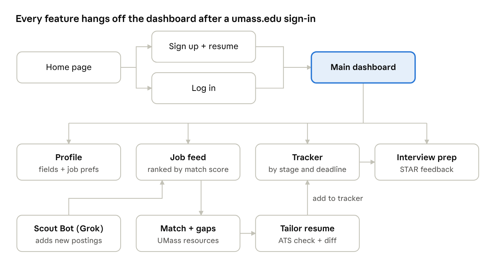
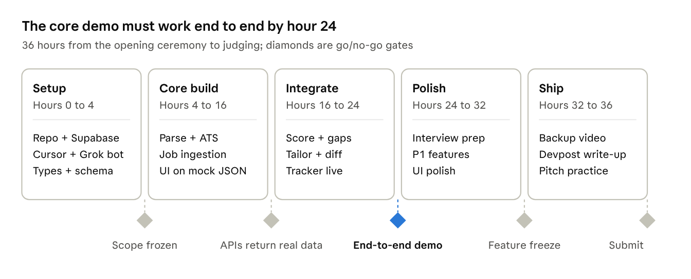

# PRD: UMass Career Coach

Nov 13, 2026 · @Miranda Liskov

## 1. Overview

UMass Career Coach is a web app that helps UMass Amherst students find internships, tailor applications to each posting, and practice interviews, with a Grok-powered Scout Bot that keeps the job feed fresh automatically.

**Pitch:** "Your personal career coach that knows UMass. It scores every internship against your resume, tailors your resume to each posting without inventing experience, points you to the UMass courses and labs that close your gaps, and tells you when your resume needs a Career Services visit. A Grok Scout Bot decides which employers to check, finds new internships and researches employers before career fairs. Job-specific mock interviews are built in too."

**Problem.** UMass students apply to dozens of postings with one generic resume. They can't tell which roles they actually qualify for, don't know which campus resources close their skill gaps, and lose track of deadlines across spreadsheets. Career Services is underused because students don't know when to go.

**Solution.** One dashboard that (1) pulls real postings from Greenhouse and Lever, (2) scores each against the student's resume and preferences, (3) points to specific UMass CICS courses and research labs to close gaps, (4) tailors resume bullets without inventing experience, (5) tracks every application by stage and deadline, and (6) runs job-specific mock interviews with STAR feedback.

**Target prizes (HackUMass, Nov 13–15, 2026)**

| Prize                                        | How this product qualifies                                                                                                                                                                                                                  |
|----------------------------------------------|---------------------------------------------------------------------------------------------------------------------------------------------------------------------------------------------------------------------------------------------|
| Best UMass Hack                              | Built for UMass students: @umass.edu login, gap plans that recommend real CICS courses and research labs (with their faculty), plus a Career Services prompt when a resume has structural issues                                            |
| Best Use of Gemini API (MLH)                 | Gemini powers personalized advice (gap plan, interview coach), analysis of complex documents (resume and posting extraction), and generated content (tailored bullets, interview questions, feedback)                                       |
| SpaceXSI "Build Your Hackathon A-Team" (MLH) | Cursor is the core AI coding agent for the team; the Grok Scout Bot decides which employers to check each run, automates job ingestion and writes employer research; both are described in the Devpost write-up; team opts in to the raffle |

## 2. Goals, non-goals and success metrics

The goal for the 36 hours is a live, deployed demo in which a judge watches a resume become a scored job, a gap plan and a tailored resume diff within three minutes (script in section 11). Interview prep is built and mentioned in one line, but shown live only if it meets the readiness bar in section 5.8.

**Goals**

1.  Show real job postings matched to a real resume with an explainable score.

2.  Tailor resumes truthfully: rephrase only, never fabricate.

3.  Tie every gap to a concrete UMass resource.

4.  Show the Grok Scout Bot choosing which employers to check and adding postings, with a visible activity log.

5.  Meet every requirement for the three target prizes.

**Non-goals (for this hackathon)**

- Applying to jobs on the user's behalf.

- Cover letter generation (stretch only; not mentioned in the pitch).

- Job sources other than Greenhouse and Lever.

- Native mobile apps, recruiter-side features, payments.

- Real Career Services appointment booking (link out instead).

**Success metrics**

| Metric                          | Target                                                                        |
|---------------------------------|-------------------------------------------------------------------------------|
| Resume upload to filled profile | Under 20 seconds, at least 80% of fields correct on 3 test resumes            |
| Jobs in feed at demo time       | At least 100 real postings from at least 10 companies                         |
| Match score explainability      | Every score shows covered and missing skills                                  |
| Tailoring fabrication rate      | 0 accepted outputs add a skill, employer or number                            |
| AI responses validated          | 100% pass zod before use; failures retried or shown as errors                 |
| Scout Bot runs logged           | At least 3 visible runs during judging, started with the Run Scout now button |
| End-to-end demo                 | Under 3 minutes, with a backup video                                          |

## 3. Users and user stories

The primary user is a UMass Amherst undergraduate or graduate student looking for an internship or first job.

| Persona                      | Situation                                        | What they need most                                    |
|------------------------------|--------------------------------------------------|--------------------------------------------------------|
| First-year explorer          | No internships yet, unsure what they qualify for | Gap plan pointing to courses and labs                  |
| Junior recruiting for summer | Applying to 30+ postings, career fair coming up  | Match scores, tailoring, tracker, employer briefs      |
| International student        | Needs visa sponsorship                           | Sponsorship filter that hides roles that won't sponsor |
| Senior / grad student        | Interviewing now                                 | Job-specific mock interviews with STAR feedback        |

**User stories**

- As a student, I sign in with my @umass.edu email so the app knows I'm a UMass student.

- As a student, I upload my resume and get a pre-filled profile I can correct, so I don't type everything twice.

- As a student, I set location, sponsorship, relocation and pay preferences so I only see jobs that fit.

- As a student, I see new postings ranked by match score, with the skills I have and the ones I'm missing.

- As a student, I get a specific CICS course or research lab for each missing skill.

- As a student, I see possible resume issues (missing sections, low keyword coverage for a posting) before I apply.

- As a student, I get tailored bullets for a posting as a before/after diff, and I trust it never invents experience.

- As a student, I track every application from saved to offer, sorted by deadlines I can set myself.

- As a student, I practice behavioral and resume questions for a specific job and get STAR-based feedback.

- As a student, I see what the Scout Bot found and when it last ran.

## 4. User flow

Students go from the home page through sign-up (with resume autofill) or log-in to the main dashboard, where every feature lives.

user flow · sign-in to dashboard features

The core demo path runs Job feed → Match + gaps → Tailor resume → Tracker, with the Scout Bot feeding new postings in the background. Interview prep is mentioned at the close and shown live only if it meets the readiness bar (section 5.8).

## 5. Functional requirements

Priority: **P0** = must ship for the demo, **P1** = should ship, **P2** = stretch.

### 5.1 Authentication and onboarding

| ID     | Requirement                                                                                                                                                                                                                                                                      | Priority |
|--------|----------------------------------------------------------------------------------------------------------------------------------------------------------------------------------------------------------------------------------------------------------------------------------|----------|
| AUTH-1 | Sign-up with full name, school email and password; only @umass.edu addresses accepted (Supabase Auth)                                                                                                                                                                            | P0       |
| AUTH-2 | Log-in with email and password; session persists across visits                                                                                                                                                                                                                   | P0       |
| AUTH-3 | Resume upload (PDF) during sign-up, stored in Supabase Storage                                                                                                                                                                                                                   | P0       |
| AUTH-4 | Resume is parsed to autofill: Academics (year, majors, minors, honors, clubs and e-board positions), Experiences (company, dates, position, skills), Skills (every canonical skill found, no cap; the profile shows the top 20 with "Show all" for the rest), Interests (max 10) | P0       |
| AUTH-5 | Every autofilled field is editable before saving                                                                                                                                                                                                                                 | P0       |
| AUTH-6 | Parse report shows what was extracted and flags low-confidence fields                                                                                                                                                                                                            | P1       |

### 5.2 Profile and job preferences

| ID     | Requirement                                                                                                 | Priority |
|--------|-------------------------------------------------------------------------------------------------------------|----------|
| PROF-1 | Dashboard profile shows all sign-up fields, each editable                                                   | P0       |
| PROF-2 | Re-upload resume; show a field-by-field diff and let the user choose which updates to apply                 | P1       |
| PROF-3 | Job preferences: needs sponsorship (y/n), open to relocation (y/n), preferred locations (list), minimum pay | P0       |

### 5.3 Job feed and Scout Bot

| ID     | Requirement                                                                                                                                                                                                                                                                                                                                                                                                                                                                                                   | Priority |
|--------|---------------------------------------------------------------------------------------------------------------------------------------------------------------------------------------------------------------------------------------------------------------------------------------------------------------------------------------------------------------------------------------------------------------------------------------------------------------------------------------------------------------|----------|
| JOB-1  | Ingest real postings from public APIs: boards-api.greenhouse.io/v1/boards/{company}/jobs and api.lever.co/v0/postings/{company} for a curated list of companies that hire UMass students                                                                                                                                                                                                                                                                                                                      | P0       |
| JOB-2  | De-duplicate postings by source + external ID, and by normalized title + company + location                                                                                                                                                                                                                                                                                                                                                                                                                   | P0       |
| JOB-3  | Scout Bot runs once a day on a Vercel cron and on demand from a "Run Scout now" button in the bot activity panel. Each run: Grok picks the companies to check (JOB-3a), plain fetch calls the Greenhouse/Lever APIs, Grok filters results to internship / new-grad roles, and new postings are stored and sent for extraction (MATCH-1a)                                                                                                                                                                      | P0       |
| JOB-3a | Grok chooses which companies to check each run. Input: the companies table (name, source, last checked, postings found last time) plus aggregate counts of how many students saved or applied to each company's jobs (no resume text or user identities). Output: up to 10 companies with a one-line reason each, as zod-validated JSON. Any company not checked in 3+ days is always added. If Grok fails or returns invalid JSON, fall back to the 10 least recently checked companies and log the fallback | P0       |
| JOB-4  | "Bot activity" panel lists each run: time, trigger (cron / manual), the companies Grok chose with its reason for each, postings added, postings extracted, errors                                                                                                                                                                                                                                                                                                                                             | P0       |
| JOB-5  | Feed sorted by match score by default; filter by location, sponsorship, role type                                                                                                                                                                                                                                                                                                                                                                                                                             | P0       |
| JOB-6  | Scout Bot writes a short employer brief per company for career-fair prep                                                                                                                                                                                                                                                                                                                                                                                                                                      | P1       |
| JOB-7  | Weekly digest email of top new matches and upcoming deadlines (Resend)                                                                                                                                                                                                                                                                                                                                                                                                                                        | P2       |

**Schedule.** The Scout Bot is not always-on. Vercel's Hobby plan runs cron jobs about once a day, so the daily cron keeps the feed fresh between sessions, and every run during judging is started with the Run Scout now button. Confirm the cron limit for the team's Vercel plan at kickoff.

### 5.4 Match score

The match score is a percentage with an explanation: skills covered, skills missing and requirement checks.

| ID       | Requirement                                                                                                                                                                                                                                                                                                                                                                                                                                                                                                                                                                                                                                               | Priority |
|----------|-----------------------------------------------------------------------------------------------------------------------------------------------------------------------------------------------------------------------------------------------------------------------------------------------------------------------------------------------------------------------------------------------------------------------------------------------------------------------------------------------------------------------------------------------------------------------------------------------------------------------------------------------------------|----------|
| MATCH-1  | Gemini extracts skills from the resume and from each posting as structured JSON (required vs preferred skills, majors, graduation window, location, sponsorship, pay)                                                                                                                                                                                                                                                                                                                                                                                                                                                                                     | P0       |
| MATCH-1a | Extraction trigger and owner. Postings: B owns the extraction function (extractPosting in lib/ai) and its zod schema; C's ingest run (/api/ingest/run) calls it right after inserting new postings, in batches of 5, and saves extracted_json on the job. A run extracts at most 40 postings so it stays inside serverless time limits; the rest stay pending for the next run. Failed extractions are marked failed, retried once at the start of the next run, and hidden from the feed until extracted. Before the demo, C runs scripts/backfill-extraction to extract the first 100+ postings. Resumes: POST /api/resume (B) extracts on every upload | P0       |
| MATCH-2  | All skills map to the canonical skill list in Appendix A (seeded from data/skills.json into the skills table) through its aliases ("JS" = "JavaScript", "Postgres" = "PostgreSQL"). Skills not on the list are dropped from matching for both postings and resumes, even if that lowers or skews scores. Dropped posting skills are saved in jobs.dropped_skills so the list can be extended later                                                                                                                                                                                                                                                        | P0       |
| MATCH-3  | Score combines required-skill coverage, preferred-skill coverage, and requirement checks (major, graduation year, location, sponsorship, pay) where the posting states them. Matching uses every canonical skill on the profile and in experiences, not only the 20 the profile shows                                                                                                                                                                                                                                                                                                                                                                     | P0       |
| MATCH-4  | Hard mismatches (student needs sponsorship and the posting says it won't sponsor; graduation year outside the posting's window) cap the score at 40% and show a red "Hard mismatch: \<reason\>" flag next to it. Hard-mismatch jobs sort below all other jobs in the feed                                                                                                                                                                                                                                                                                                                                                                                 | P0       |
| MATCH-5  | Display as "82%" plus bullets: "Has Python, React" / "Missing Docker" / "Missing SQL"                                                                                                                                                                                                                                                                                                                                                                                                                                                                                                                                                                     | P0       |
| MATCH-6  | If a posting lists no required skills after mapping to the canonical list, the score shows "N/A" with "No required skills listed". Preferred-skill coverage and requirement checks still appear as bullets, hard-mismatch flags still show, and N/A jobs sort after scored jobs                                                                                                                                                                                                                                                                                                                                                                           | P0       |

Proposed scoring (tune during the hackathon):

$$\text{score} = 0.5\,R + 0.2\,P + 0.3\,Q$$

R = share of required skills covered, P = share of preferred skills covered, Q = share of applicable requirement checks passed. Skills a posting doesn't list are ignored rather than counted against the student. If a posting has no preferred skills, or no requirement checks apply, that weight moves to R. If it has no required skills, the score is N/A (MATCH-6). A hard mismatch caps the result at 40% (MATCH-4). Because off-list skills are dropped, more postings may end up N/A; check dropped_skills after the first ingest and extend the list if many demo postings are affected.

### 5.5 Gap feedback

| ID     | Requirement                                                                                                                                                                                                                                                                                                                                                                                      | Priority |
|--------|--------------------------------------------------------------------------------------------------------------------------------------------------------------------------------------------------------------------------------------------------------------------------------------------------------------------------------------------------------------------------------------------------|----------|
| GAP-1  | For each missing skill, recommend matching CICS courses and research labs (with the lab's faculty). Recommendations come only from these two sources; if nothing matches a skill, say so rather than suggesting anything else                                                                                                                                                                    | P0       |
| GAP-2  | Course recommendations come from the official CICS course descriptions page (https://content.cs.umass.edu/content/spring-2026-course-descriptions), parsed into the umass_resources table. The model may only recommend courses that exist in that table                                                                                                                                         | P0       |
| GAP-2a | Course sync job (/api/ingest/courses, person C) fetches the page, parses each course (code, title, instructors, prerequisites, description) and upserts it. Gemini tags each course with skills from the canonical skill list; zod drops any tag not on the list                                                                                                                                 | P0       |
| GAP-2b | Freshness check: the job re-checks the link daily and on a manual "Refresh courses" button in the bot activity panel. It hashes the page content and re-parses only when the hash changes; each check is logged in bot_runs (courses found, added, changed, removed)                                                                                                                             | P0       |
| GAP-2c | If the fetch or parse fails, or returns far fewer courses than last time, keep the last good data and fall back to the bundled seed file (data/umass_resources.json). Courses that disappear from the page are marked inactive, not deleted                                                                                                                                                      | P0       |
| GAP-2e | Lab sync job (/api/ingest/labs, person C) reads the CICS Centers & Labs directory (https://www.cics.umass.edu/organizations) across all pages, storing each lab's name, short description, link, type and research area. It then opens each lab's own page to collect its faculty names and public CICS profile links. Runs weekly with the same hash check, logging and fallback as courses     | P1       |
| GAP-2f | Gemini tags each lab with canonical skills and research areas (zod-validated). When a student's missing skills or interests match a lab, the gap plan suggests the lab and its faculty, with a "why this lab" line grounded only in the lab's own description                                                                                                                                    | P1       |
| GAP-2g | Contacting professors is student-initiated: the app links to the professor's public profile page and drafts an outreach email (referencing the lab's stated research and the student's real experience) that the student reviews and sends themselves. The app never emails faculty, stores no contact details beyond the public profile URL, and never invents faculty, labs or research topics | P1       |
| GAP-3  | Gemini writes a short personalized plan that ranks the resources for this student                                                                                                                                                                                                                                                                                                                | P1       |

The page is checked on a schedule, not on every student request: a live fetch per request would add seconds to each gap lookup and break the feature whenever the page is slow or changes layout. Each course card in the UI links back to the page so students can confirm details.

### 5.6 Resume tailoring and ATS checks

| ID        | Requirement                                                                                                                                                                                                                                                                                                                                                                                                                                                                                                                                                                                                                                                                                     | Priority |
|-----------|-------------------------------------------------------------------------------------------------------------------------------------------------------------------------------------------------------------------------------------------------------------------------------------------------------------------------------------------------------------------------------------------------------------------------------------------------------------------------------------------------------------------------------------------------------------------------------------------------------------------------------------------------------------------------------------------------|----------|
| ATS-1     | Before tailoring, check two things: missing standard sections (Education, Experience, Skills) and keyword coverage against the posting (share of the posting's canonical skills found in the resume text). Results are labeled "possible issues", not a guarantee about any particular applicant tracking system                                                                                                                                                                                                                                                                                                                                                                                | P0       |
| ATS-1b    | Layout checks: multi-column layouts, tables and text inside images, using the text positions from the PDF parser                                                                                                                                                                                                                                                                                                                                                                                                                                                                                                                                                                                | P2       |
| ATS-2     | When a possible issue is found, show it and prompt the student to talk to Career Services about their resume (no specific service or appointment)                                                                                                                                                                                                                                                                                                                                                                                                                                                                                                                                               | P0       |
| TAILOR-1  | Gemini rewrites only existing bullets to highlight skills and interests relevant to the posting                                                                                                                                                                                                                                                                                                                                                                                                                                                                                                                                                                                                 | P0       |
| TAILOR-2  | Show a before/after diff per bullet; the user accepts or rejects each                                                                                                                                                                                                                                                                                                                                                                                                                                                                                                                                                                                                                           | P0       |
| TAILOR-3  | Reject any rewritten bullet that contains a skill, employer or number that isn't in that same original bullet. The check compares against the original bullet only, not the rest of the resume, so a skill can't be moved into a bullet where it wasn't used. On rejection, retry once, then drop the bullet. The diff view shows how many rewrites were blocked and why                                                                                                                                                                                                                                                                                                                        | P0       |
| TAILOR-3a | Number normalization (lib/resume/numbers.ts) runs on both bullets before the sets of values are compared: lowercase and strip commas (1,000 → 1000); convert written numbers to digits from zero up to 999,999, including hyphenated forms and "a dozen" (twenty-five → 25); expand k / m / b suffixes (5k → 5000, 1.2M → 1200000); treat "percent" and "%" alike (forty percent → 40%); split ranges into both ends (3–5 → 3 and 5). Vague quantities (dozens, hundreds, thousands) count as new claims if the original lacks them. "One", "a" and ordinals such as "first" are not converted, since they usually aren't quantities. Covered by unit tests with at least 20 before/after pairs | P0       |
| TAILOR-4  | Export the tailored resume as text or PDF                                                                                                                                                                                                                                                                                                                                                                                                                                                                                                                                                                                                                                                       | P1       |
| TAILOR-5  | "Add to application tracker" button on the job and tailoring views                                                                                                                                                                                                                                                                                                                                                                                                                                                                                                                                                                                                                              | P0       |
| TAILOR-6  | Cover letter draft using the same no-fabrication rules                                                                                                                                                                                                                                                                                                                                                                                                                                                                                                                                                                                                                                          | P2       |

### 5.7 Application tracker

| ID      | Requirement                                                                                                                                                                                    | Priority |
|---------|------------------------------------------------------------------------------------------------------------------------------------------------------------------------------------------------|----------|
| TRACK-1 | Columns by stage: Saved, Applied, Interviewing, Offer                                                                                                                                          | P0       |
| TRACK-2 | Within each stage, rank jobs by soonest deadline; jobs without a deadline go last, labeled "No deadline"                                                                                       | P0       |
| TRACK-3 | Change a job's stage from its card (e.g. Saved to Applied)                                                                                                                                     | P0       |
| TRACK-4 | Each card links to its posting, match score, tailored resume and interview prep                                                                                                                | P1       |
| TRACK-5 | Students set or edit a deadline on any card with a date picker. A deadline from the posting (Greenhouse and Lever rarely provide one) only pre-fills the field; the student's date always wins | P0       |

### 5.8 Interview prep

| ID     | Requirement                                                                                                                                                               | Priority |
|--------|---------------------------------------------------------------------------------------------------------------------------------------------------------------------------|----------|
| PREP-1 | Generate behavioral questions from the job posting                                                                                                                        | P0       |
| PREP-2 | Generate resume questions from the student's own experiences                                                                                                              | P0       |
| PREP-3 | Student answers in text (voice is P2); Gemini gives feedback against the STAR method (Situation, Task, Action, Result) with a per-part rating and a suggested improvement | P0       |
| PREP-4 | Save sessions so students can review past answers                                                                                                                         | P1       |

**Demo rule.** Interview prep is built as planned but left out of the live demo by default; the pitch mentions it in one line. It goes into the demo only if, at the hour-30 check, it (1) gives relevant questions for the demo posting on three tries in a row, (2) returns STAR feedback in under 10 seconds, and (3) has no zod failures in those runs. If it passes, use the optional segment in the demo script (section 11).

## 6. Non-functional requirements

Trust is the product's main promise: every AI output is validated, and the tailoring never invents experience.

| Area                     | Requirement                                                                                                                                                                                                   |
|--------------------------|---------------------------------------------------------------------------------------------------------------------------------------------------------------------------------------------------------------|
| AI validation            | Every Gemini call uses structured JSON output and is parsed with a zod schema before use; on failure, retry once, then show a clear error                                                                     |
| Truthfulness             | Tailoring runs a deterministic check that compares the skills, employers and normalized numbers (TAILOR-3a) in each rewritten bullet against that same original bullet only; any new item rejects the bullet  |
| Grounded recommendations | Gap recommendations come only from the synced CICS course and lab data; the model ranks and explains them but cannot add new ones                                                                             |
| Privacy                  | Resumes stored in a private Supabase bucket; row-level security so users only read their own profile, resumes and tracker; no resume text sent to Grok (it sees only company names and aggregate save counts) |
| Secrets                  | Gemini, xAI and Resend keys live in Vercel environment variables, never in the client                                                                                                                         |
| Performance              | Resume parse under 20 s; feed loads under 2 s from cached scores; tailoring under 15 s                                                                                                                        |
| Cost and rate limits     | Posting extraction cached per posting; scores recomputed only when profile or posting changes                                                                                                                 |
| Reliability              | Scout Bot failures are logged in the activity panel and don't block the app; seeded demo data as fallback                                                                                                     |
| Accessibility            | Keyboard navigable, labeled form fields, sufficient color contrast (shadcn/ui defaults)                                                                                                                       |

## 7. Technical architecture

A single Next.js app on Vercel, backed by Supabase, calls Gemini for all student-facing AI and Grok for the Scout Bot.

### 7.1 Stack

| Layer             | Choice                                                              | Why                                                                   |
|-------------------|---------------------------------------------------------------------|-----------------------------------------------------------------------|
| App               | Next.js (App Router, TypeScript strict), Tailwind, shadcn/ui        | Fast to build, one repo for UI and API routes                         |
| Database and auth | Supabase: Postgres, Auth restricted to @umass.edu, Storage for PDFs | Auth, DB and file storage in one service                              |
| AI                | Gemini with structured JSON output; zod validates every response    | Required for the Gemini prize; typed, safe outputs                    |
| Automation        | Grok (xAI API) Scout Bot                                            | Required for the SpaceXSI prize                                       |
| PDF parsing       | unpdf or pdfjs-dist (not pdf-parse)                                 | Returns text positions, needed for the P2 multi-column check (ATS-1b) |
| Email             | Resend                                                              | Digest and deadline emails                                            |
| Hosting and cron  | Vercel (cron as fallback for the Scout Bot schedule)                | Zero-config deploy                                                    |

### 7.2 Data model

| Table              | Key columns                                                                                                                                                                                                                            |
|--------------------|----------------------------------------------------------------------------------------------------------------------------------------------------------------------------------------------------------------------------------------|
| profiles           | user_id, full_name, email, year, majors\[\], minors\[\], honors\[\], clubs (jsonb), skills\[\] (canonical, no cap; UI shows top 20), interests\[\] (max 10), needs_sponsorship, open_to_relocation, preferred_locations\[\], min_pay   |
| experiences        | id, user_id, company, position, start_date, end_date, bullets\[\], skills\[\]                                                                                                                                                          |
| resumes            | id, user_id, storage_path, raw_text, parsed_json, ats_report (jsonb), uploaded_at                                                                                                                                                      |
| skills             | id, canonical_name, aliases\[\], category                                                                                                                                                                                              |
| companies          | id, name, source (greenhouse / lever), slug, active, last_checked_at, last_postings_found                                                                                                                                              |
| jobs               | id, source (greenhouse / lever), external_id, company, title, location, url, description, posted_at, deadline, extracted_json, extraction_status (pending / done / failed), dropped_skills\[\], ingested_by_run_id                     |
| matches            | user_id, job_id, score, covered_skills\[\], missing_skills\[\], requirement_checks (jsonb), computed_at                                                                                                                                |
| umass_resources    | id, type (course / lab), name, url, skills\[\], description, meta (jsonb: courses: code, instructors, prereqs, level, semester; labs: research_area, faculty \[name, profile_url\]), source_url, content_hash, active, last_checked_at |
| applications       | id, user_id, job_id, stage (saved / applied / interviewing / offer), deadline, deadline_source (user / posting), notes, updated_at                                                                                                     |
| tailorings         | id, user_id, job_id, resume_id, bullet_diffs (jsonb), rejected_count, created_at                                                                                                                                                       |
| interview_sessions | id, user_id, job_id, questions (jsonb), answers (jsonb), feedback (jsonb), created_at                                                                                                                                                  |
| bot_runs           | id, started_at, finished_at, trigger (cron / manual), companies_selected (jsonb: company, reason, fallback), companies_checked, jobs_added, briefs_written, errors (jsonb)                                                             |
| company_briefs     | company, summary, talking_points\[\], generated_at                                                                                                                                                                                     |

### 7.3 API routes

| Route                       | Owner | Purpose                                                                                                                                      |
|-----------------------------|-------|----------------------------------------------------------------------------------------------------------------------------------------------|
| POST /api/resume            | B     | Upload, parse, run ATS checks, return parse report                                                                                           |
| POST /api/match             | B     | Compute or refresh scores for a user                                                                                                         |
| POST /api/tailor            | B     | Rewrite bullets for a job, run the fabrication check, return diffs                                                                           |
| POST /api/gaps              | B     | Map missing skills to UMass resources and personalized plan                                                                                  |
| POST /api/interview         | B     | Generate questions; grade answers against STAR                                                                                               |
| GET/PATCH /api/applications | A/B   | Read and update tracker stages                                                                                                               |
| POST /api/ingest/run        | C     | Scout Bot entry point (cron or manual): Grok picks companies, fetch, filter, de-duplicate, store, extract (MATCH-1a), log run                |
| GET /api/ingest/runs        | C     | Bot activity panel data                                                                                                                      |
| POST /api/ingest/courses    | C     | Check the CICS course page, re-parse if changed, tag skills, upsert courses, log the run                                                     |
| POST /api/ingest/labs       | C     | Read the CICS Centers & Labs directory and each lab page, tag skills and research areas, upsert labs with faculty profile links, log the run |

## 8. Team, workflow and prize compliance

Three owners split the code by folder so Cursor and Claude Code never edit the same files.

| Role                    | Owns                                                                                                                                                                                                                                 | Main tool              |
|-------------------------|--------------------------------------------------------------------------------------------------------------------------------------------------------------------------------------------------------------------------------------|------------------------|
| A: Frontend / UX        | app/ pages and components/: login, upload and parse report, job feed with scores, tailoring diff view, gap plan, tracker, interview UI, polish. Builds against mock JSON until APIs are ready                                        | Cursor                 |
| B: Resume and AI core   | lib/resume, lib/match, lib/ai, and the resume, match, tailor, gaps and interview API routes: PDF parsing, ATS checks, skill extraction, scoring, fabrication check. Sole owner of the database schema and lib/types.ts               | Claude Code            |
| C: Bots, data and pitch | app/api/ingest/\*, scripts/, Grok Scout Bot routines: company selection, job ingestion and de-duplication, calling posting extraction, company briefs, digest email, CICS course and lab sync, demo data, Devpost, backup demo video | Cursor and Claude Code |

**Workflow rules**

- Each person edits only their own folders, on their own branch, and merges small pull requests into main every 2–3 hours.

- If Claude Code and Cursor run on the same laptop, each gets its own git worktree.

- The same rules live in CLAUDE.md and .cursor/rules/project.mdc:

  - Next.js App Router + TS strict. Shared types live only in lib/types.ts (owner: B).

  - Validate every AI output with zod; never trust raw model JSON.

  - Tailoring may only rephrase existing bullets; never add skills, employers or numbers.

  - Stay inside your owned folders; ask before touching another owner's files.

  - Small commits; run npm run build before pushing.

**Prize compliance checklist**

- [ ] Cursor used as the core AI coding agent (screenshots of Agent mode taken throughout)

- [ ] Grok Scout Bot automation running, with screenshots of the activity panel and bot runs

- [ ] Devpost section "How we used Cursor and Grok Bot" written

- [ ] Opted in to the "Make it Legendary with SpaceXSI" raffle at submission

- [ ] Gemini used for advice (gap plan, interview coach), analysis (resume and posting extraction) and generation (tailored bullets, questions) — called out in Devpost

- [ ] UMass-specific features (umass.edu login, CICS course and lab recommendations, Career Services prompt for resume issues) shown in the demo

- [ ] No project code or repo created before the opening ceremony

- [ ] At least one teammate present for judging on the last day

Claude Code (person B) is a third AI tool, so the Devpost should be clear that Cursor is the team's core coding agent, as the SpaceXSI prize requires. Confirm with the MLH rep that mixing tools is allowed.

## 9. Milestones and scope

The P0 path (upload → score → gaps → tailor → tracker) must work end to end by hour 24. Everything after that is polish and P1.

36-hour plan · 5 phases, 5 gates

If the end-to-end gate is missed at hour 24, drop all P1/P2 items and spend hours 24–32 fixing the core path.

| Scope        | Features                                                                                                                                                                                                                                                                                                                                                                                                                                                                                           |
|--------------|----------------------------------------------------------------------------------------------------------------------------------------------------------------------------------------------------------------------------------------------------------------------------------------------------------------------------------------------------------------------------------------------------------------------------------------------------------------------------------------------------|
| MVP (P0)     | umass.edu auth, resume parse + autofill, preferences, Greenhouse/Lever ingestion, Scout Bot with Grok company selection + activity panel, match score with covered/missing skills (40% cap on hard mismatches, N/A with no required skills), gap resources, ATS check (sections + keyword coverage), truthful tailoring with per-bullet check and number normalization, tracker with user-set deadlines, interview questions + STAR feedback (in the live demo only if it meets the readiness bar) |
| Should (P1)  | Parse confidence flags, resume re-upload diff, employer briefs, personalized gap plan, tailored resume export, tracker card links, saved interview sessions                                                                                                                                                                                                                                                                                                                                        |
| Stretch (P2) | Weekly digest email, cover letters, voice interview answers, ATS layout checks (ATS-1b)                                                                                                                                                                                                                                                                                                                                                                                                            |

## 10. Risks, open questions and judge Q&A

The biggest risk is scope: eight features in 36 hours. Protect the P0 demo path first.

| Risk                                                                   | Mitigation                                                                                                                                               |
|------------------------------------------------------------------------|----------------------------------------------------------------------------------------------------------------------------------------------------------|
| Scope too large                                                        | Freeze P0 list at hour 4; cut P1/P2 at hour 24 if the core path isn't working end to end                                                                 |
| Resume parsing is inaccurate on unusual layouts                        | Editable fields; test on 3+ real team resumes; low-confidence fields flagged in the parse report                                                         |
| Gemini returns invalid JSON or hallucinates                            | zod validation + one retry; deterministic fabrication check on tailoring                                                                                 |
| Gemini rate limits during judging                                      | Cache extractions and scores; pre-warm demo account                                                                                                      |
| Greenhouse/Lever company slugs wrong or empty                          | Curate and verify the company list early (person C); keep seeded jobs as fallback                                                                        |
| Grok Bot requirement interpreted differently by MLH                    | Ask the MLH rep in the first 3 hours                                                                                                                     |
| Wi-Fi or deploy fails at demo time                                     | Backup demo video recorded by hour 32                                                                                                                    |
| Merge conflicts between tools                                          | Folder ownership, small PRs, worktrees                                                                                                                   |
| Course page layout changes, goes down or is replaced by a new semester | Hash check + sanity check on course count; keep last good data; bundled seed file as fallback; update the URL when the next semester's page is published |
| Faculty outreach feels like spam or misuses faculty data               | Public lab and profile pages only; no email scraping or automated sending; student reviews every draft; drafts must cite the lab's real research         |
| Lab pages vary in layout, so faculty names are hard to extract         | Use Gemini to extract faculty from each lab page with a strict schema; if none found, show the lab link only; hand-check the labs used in the demo       |

**Open questions**

- Which companies go in the Greenhouse/Lever list? (Aim for 15–25 that hire UMass students.)

- Skills no CICS course or lab covers (e.g. React, PostgreSQL, Kubernetes): the gap plan shows "no UMass match found" for these. Resolved for the demo: the demo posting is chosen so its gaps are covered by CICS courses or labs (section 11). The "no UMass match found" message stays for real use.

- Resolved: Grok picks which companies to check, filters roles and writes briefs; plain fetch calls the APIs.

- Text-only interview answers, or voice too? (Text for P0.)

**Likely judge questions**

| Question                                         | Answer to prepare                                                                                                                                                                                                    |
|--------------------------------------------------|----------------------------------------------------------------------------------------------------------------------------------------------------------------------------------------------------------------------|
| How is this different from Handshake or Jobscan? | It ties every gap to a real UMass resource, and tailoring is guaranteed not to invent experience                                                                                                                     |
| How do you stop the AI from lying on a resume?   | Rephrase-only prompt, structured output, plus a deterministic check that rejects any new skill, employer or number                                                                                                   |
| How is the match score calculated?               | Canonical skill mapping, weighted required/preferred coverage and requirement checks; hard mismatches cap at 40%, postings with no required skills show N/A, and every score shows its reasons                       |
| What does Grok actually do?                      | Each run, Grok decides which employers to check based on freshness and what students are saving, filters new postings to internships, writes employer briefs, and logs its choices and reasons in the activity panel |
| How did you use Cursor?                          | Core coding agent for frontend and bots; show screenshots and commits                                                                                                                                                |
| Is resume data safe?                             | Private storage, row-level security, keys server-side, no resume text sent to the bot                                                                                                                                |
| How would this scale beyond the hackathon?       | Partner with UMass Career Services; add more job sources and other schools' resource tables                                                                                                                          |

## 11. Demo script

A 3-minute live demo of the P0 path, driven from a fresh sign-up. The goal is one continuous story: one student, one resume, one posting.

### Before every demo run

- Run scripts/reset-demo to delete the demo user, so sign-up and autofill happen live. Email confirmation is off for the demo address.

- Demo resume: a teammate's real resume, single column, that parses at 80%+ accuracy and is missing a Skills section (so the ATS check has something to show).

- Demo posting: a real ingested posting, scored about 75–85% for the demo resume, whose missing skills (for example machine learning, statistics or distributed systems) map to CICS courses or labs. Also note one hard-mismatch posting (sponsorship or graduation year) and one N/A posting.

- Pre-warm: extraction done for all feed postings, scores cached, tailoring run once on the demo posting so Gemini responses are quick.

- Fallbacks ready: the backup video on the desktop, and previous Scout runs visible in the activity panel in case a live run fails.

- Roles: one person drives the laptop and one narrates; decide by hour 30 and rehearse at least three times.

### Run of show

| Time      | Screen                    | Do                                                                                                                                                                | Say                                                                                                                                                                                                                                                                                                    |
|-----------|---------------------------|-------------------------------------------------------------------------------------------------------------------------------------------------------------------|--------------------------------------------------------------------------------------------------------------------------------------------------------------------------------------------------------------------------------------------------------------------------------------------------------|
| 0:00–0:15 | Home page                 | Nothing yet                                                                                                                                                       | "UMass students send one generic resume to dozens of postings and can't tell which roles they qualify for or how to close the gap. We built a career coach that knows UMass."                                                                                                                          |
| 0:15–0:40 | Sign-up                   | Sign up with the demo @umass.edu address and upload the demo resume. Show the autofilled profile and parse report; fix one field                                  | "UMass login only. Drop in a resume and Gemini fills in your profile: majors, experiences, skills. Everything stays editable."                                                                                                                                                                         |
| 0:40–0:50 | Bot activity panel        | Click Run Scout now and leave it running                                                                                                                          | "While we look around, our Grok Scout Bot is picking which employers to check right now. We'll come back to it."                                                                                                                                                                                       |
| 0:50–1:15 | Job feed                  | Show the feed sorted by score. Point to the demo posting's score with covered and missing skills, then the hard-mismatch card with its red flag                   | "Real postings from Greenhouse and Lever, ranked for this student. Every score shows why. This one needs sponsorship the employer doesn't offer, so it's capped and flagged instead of hidden in an average."                                                                                          |
| 1:15–1:40 | Gap plan                  | Open the demo posting's gaps. Show a CICS course and a research lab with its faculty for a missing skill; click through to the course page                        | "Each missing skill maps to a real CICS course or lab, pulled from the official CICS pages. The model can only recommend what's actually there."                                                                                                                                                       |
| 1:40–2:15 | ATS check, then tailoring | Show the possible issue (missing Skills section) and the Career Services prompt. Run tailoring; accept two bullets; point to the blocked-rewrite count and reason | "Before tailoring, we flag possible resume issues and point you to Career Services. Then Gemini rewrites your bullets for this posting, and a deterministic check blocks any rewrite that adds a skill, employer or number that wasn't in that bullet. Here it blocked one that made up a percentage." |
| 2:15–2:35 | Tracker                   | Click Add to tracker. Set a deadline with the date picker and show the card move into deadline order                                                              | "Every application in one place, sorted by the deadlines you set."                                                                                                                                                                                                                                     |
| 2:35–2:50 | Bot activity panel        | Open the run started at 0:40: the companies Grok chose, its reasons and the postings it added                                                                     | "Grok chose these employers because they hadn't been checked recently and students are saving their jobs, then filtered to internships. Every run is logged."                                                                                                                                          |
| 2:50–3:00 | Dashboard                 | Close                                                                                                                                                             | "We also built job-specific mock interviews with STAR feedback. UMass Career Coach: real jobs, honest tailoring and UMass resources for every gap."                                                                                                                                                    |

**Optional interview segment (20 s).** Only if interview prep passes the readiness bar (section 5.8): cut the hook to 5 seconds and the tracker segment to 10 seconds, and use the 20 seconds saved after tailoring to generate one behavioral question for the demo posting, submit a prepared answer and show the STAR ratings. Replace the closing line's interview mention with the product line alone.

**Recovery.** If something fails live: a slow Gemini call gets one sentence of narration while it loads; a failed Scout run shows the previous logged run; anything worse switches to the backup video at the same timestamp.

## Appendix A. Canonical skill list

The starting list for MATCH-2, seeded to data/skills.json. Matching is case-insensitive on canonical names and aliases, except that short names (C, R, Go) match only as whole words and case-sensitive, so "go to market" and "R&D" don't count. Skills found on a posting or resume that aren't here are dropped from matching and logged in jobs.dropped_skills. The CS fundamentals rows are deliberately included because CICS courses teach them, which keeps the gap plan useful.

| Category                   | Canonical skills (aliases in parentheses)                                                                                                                                                                                                                                                                                                                                                                                                                             |
|----------------------------|-----------------------------------------------------------------------------------------------------------------------------------------------------------------------------------------------------------------------------------------------------------------------------------------------------------------------------------------------------------------------------------------------------------------------------------------------------------------------|
| Languages                  | Python (py, python3); Java; JavaScript (JS, ECMAScript, ES6); TypeScript (TS); C; C++ (cpp); C# (csharp); Go (Golang); Rust; Kotlin; Swift; R; MATLAB; SQL; Bash (shell, shell scripting); Scala; Ruby; PHP                                                                                                                                                                                                                                                           |
| Frontend and mobile        | HTML (HTML5); CSS (CSS3, Sass, SCSS); React (React.js, ReactJS); Next.js (NextJS); Angular (AngularJS); Vue (Vue.js); Tailwind CSS (Tailwind); Redux; React Native; iOS development (iOS, UIKit, SwiftUI); Android development (Android SDK, Jetpack Compose)                                                                                                                                                                                                         |
| Backend                    | Node.js (Node, NodeJS); Express (Express.js); Django; Flask; FastAPI; Spring (Spring Boot); Ruby on Rails (Rails); REST APIs (REST, RESTful); GraphQL; gRPC; Microservices                                                                                                                                                                                                                                                                                            |
| Databases                  | PostgreSQL (Postgres); MySQL; SQLite; MongoDB (Mongo); Redis; DynamoDB; Snowflake; BigQuery; Database systems (database design, data modeling)                                                                                                                                                                                                                                                                                                                        |
| Data and ML                | Machine learning (ML); Deep learning (neural networks); PyTorch (Torch); TensorFlow (TF, Keras); scikit-learn (sklearn); pandas; NumPy; Natural language processing (NLP); Computer vision (CV); Large language models (LLMs, generative AI, GenAI); Reinforcement learning (RL); Statistics (statistical analysis, probability); Data analysis (data analytics); Data visualization (matplotlib, seaborn); Apache Spark (Spark, PySpark); Jupyter (Jupyter Notebook) |
| Cloud and DevOps           | AWS (Amazon Web Services, EC2, S3, Lambda); Google Cloud (GCP); Microsoft Azure (Azure); Docker (containers, containerization); Kubernetes (K8s); CI/CD (continuous integration, GitHub Actions, Jenkins); Terraform (infrastructure as code, IaC); Linux (Unix); Git (GitHub, GitLab, version control)                                                                                                                                                               |
| CS fundamentals            | Data structures; Algorithms; Object-oriented programming (OOP); Operating systems (OS); Computer networks (networking, TCP/IP); Distributed systems; Computer architecture; Compilers; Concurrency (multithreading, parallel programming); Cybersecurity (security, information security); Cryptography; Embedded systems (firmware, microcontrollers, Arduino); Human-computer interaction (HCI)                                                                     |
| Engineering practice       | Software engineering (SDLC); Testing (unit testing, Jest, pytest, JUnit); Agile (Scrum); Code review; API design                                                                                                                                                                                                                                                                                                                                                      |
| Design and analytics tools | Figma; UI/UX design (UX, UI design, user experience); Excel (Microsoft Excel, spreadsheets); Tableau; Power BI                                                                                                                                                                                                                                                                                                                                                        |
